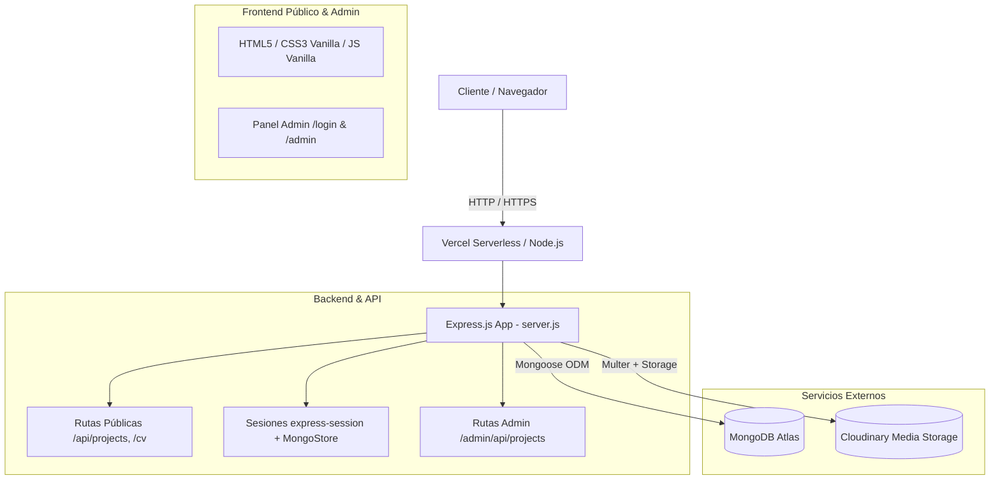

# CONTEXT.md — GaboDev Personal Portfolio

Documentación técnica y contextual integral del proyecto **GaboDev Portfolio**.

---

## 1. Resumen y Propósito del Proyecto

**GaboDev Portfolio** es el sitio web de portafolio profesional de **Gabriel Leandro Reina (GaboDev)**, Programador Web y Desarrollador de Software Full Stack.

- **URL en Producción**: [portafolio-gabo-dev.vercel.app](https://portafolio-gabo-dev.vercel.app)
- **Concepto Visual & Estética**: Inspirado en la interfaz táctica y HUD militar/tecnológico de *Metal Gear Solid*, con acabados sci-fi, efectos glitch, scanlines, retícula de apuntado interactiva, modo claro por defecto y modo oscuro conmutables, tipografías condensadas y un diseño de alto impacto visual sin depender de frameworks pesados en el cliente.
- **Capacidades Dinámicas**: Cuenta con una API REST en Node.js/Express conectada a MongoDB Atlas para gestionar proyectos dinámicamente y Cloudinary para almacenamiento y optimización de activos multimedia (imágenes y videos). Además, incluye un panel de administración protegido por autenticación para crear, editar y eliminar proyectos sin modificar el código fuente.

---

## 2. Arquitectura General del Sistema



- **Modelo de Despliegue**: Híbrido. Funciona como servidor Node.js estándar en entornos locales (`node server.js` / `nodemon`) y como función serverless exportando un handler con conexión persistente/reutilizada a MongoDB en Vercel.
- **Frontend**: Vanilla HTML5, Vanilla CSS3 y Vanilla JavaScript (sin empaquetadores como Webpack ni frameworks como React/Vue en el cliente final), garantizando tiempos de carga ultrarrápidos y total control del DOM.
- **Backend**: Express 4 con middlewares de parseo JSON/URL-encoded, gestión de sesiones (`express-session` con persistencia en `connect-mongo`), y gestión de archivos en la nube con `multer-storage-cloudinary`.

---

## 3. Estructura de Directorios y Archivos

```
PortafolioGaboDev/
├── .gitignore                   # Exclusiones de control de versiones (.env, node_modules)
├── CV.pdf                       # Currículum Vitae descargable servido en /cv
├── CONTEXT.md                   # Documento de contexto integral del proyecto (este archivo)
├── README.md                    # Documentación general y guía de instalación
├── favicon.ico                  # Favicon del sitio web
├── package.json                 # Metadatos del proyecto y dependencias npm
├── package-lock.json            # Árbol de dependencias bloqueado
├── server.js                    # Servidor Express, API REST, conexión DB y handler Vercel
├── vercel.json                  # Configuración de despliegue y enrutamiento serverless en Vercel
│
├── public/                      # Archivos estáticos servidos directamente por Express
│   ├── index.html               # Página principal del portafolio (Single Page)
│   ├── styles.css               # Hoja de estilos principal (temas claro/oscuro, animaciones, HUD)
│   ├── main.js                  # Lógica del cliente (temas, observers, animaciones, filtros, modal)
│   ├── 404.html                 # Página de error 404 personalizada con temática táctica
│   │
│   ├── img/                     # Recursos gráficos locales
│   │   ├── foto.jpg             # Fotografía de perfil para el dossier
│   │   ├── negro.png            # Logo oscuro para modo claro
│   │   └── logo blanco.png      # Logo blanco para modo oscuro
│   │
│   └── admin/                   # Interfaz del panel de administración
│       ├── index.html           # Dashboard administrativo (CRUD de proyectos, métricas)
│       └── login.html           # Pantalla de acceso táctico con login seguro
```

---

## 4. Stack Tecnológico y Dependencias

### Lenguajes y Núcleo
- **Node.js** (Entorno de ejecución de backend)
- **JavaScript (ES6+)** (Tanto en backend como en frontend)
- **HTML5 Semántico** y **CSS3 Moderno** (Variables CSS, Flexbox, Grid, Animaciones por Keyframes)

### Dependencias Principales (`package.json`)
| Paquete | Versión | Propósito |
|---|---|---|
| `express` | `^4.18.2` | Framework web para rutas, middlewares y servidor HTTP |
| `mongoose` | `^8.0.3` | ODM para modelado y conexión con MongoDB |
| `express-session` | `^1.17.3` | Manejo de sesiones de usuario para el panel de administración |
| `connect-mongo` | `^5.1.0` | Almacenamiento persistente de sesiones en MongoDB |
| `multer` | `^1.4.5-lts.1` | Middleware para gestión de peticiones `multipart/form-data` |
| `cloudinary` | `^1.41.3` | SDK oficial de Cloudinary para subida y transformación de multimedia |
| `multer-storage-cloudinary` | `^4.0.0` | Motor de almacenamiento que conecta Multer directamente con Cloudinary |
| `dotenv` | `^16.3.1` | Carga de variables de entorno desde archivo `.env` |
| `bcryptjs` | `^2.4.3` | Utilidad para hashing y verificación de contraseñas |
| `ejs` | `^3.1.9` | Motor de plantillas (configurado en Express) |
| `nodemon` *(dev)* | `^3.0.2` | Reinicio automático del servidor en desarrollo |

### Recursos Externos y CDNs
- **Google Fonts**:
  - `Bebas Neue`: Títulos principales y acentos numéricos.
  - `Share Tech Mono`: Estilo terminal, métricas y etiquetas técnicas.
  - `Rajdhani`: Textos de lectura, cuerpo general y UI táctica.
  - `Barlow Condensed`: Subtítulos y jerarquías secundarias.
- **Font Awesome 6.5.1**: Iconografía técnica, redes sociales y controles interactivos.

---

## 5. Base de Datos y Modelado de Datos

### Modelo: `Project` (`server.js`)
Colección que almacena los proyectos expuestos en la galería del portafolio:

```javascript
const projectSchema = new mongoose.Schema({
  title      : { type: String, required: true },
  description: { type: String, default: '' },
  category   : { 
    type: String, 
    enum: ['programming', 'web', 'design', 'video'], 
    required: true 
  },
  imageUrl   : { type: String, default: '' },
  videoUrl   : { type: String, default: '' },
  githubUrl  : { type: String, default: '' },
  tags       : [String],
  link       : { type: String, default: '' },
  featured   : { type: Boolean, default: false },
  order      : { type: Number, default: 0 },
  createdAt  : { type: Date, default: Date.now },
});
```

- **Categorías soportadas**:
  - `programming`: Software, scripts, algoritmos, backend, APIs.
  - `web`: Aplicaciones web y sitios interactivos frontend/full-stack.
  - `design`: Diseño gráfico, UI/UX, branding, material visual.
  - `video`: Edición de video, postproducción y motion graphics.
- **Soporte Multimedia**: Admite URLs directas de Cloudinary (imágenes o videos) o enlaces externos (incluyendo conversión automática a embed para videos de YouTube).

---

## 6. Endpoints de la API y Enrutamiento

### Rutas Públicas
| Método | Ruta | Descripción |
|---|---|---|
| `GET` | `/` | Sirve `public/index.html` |
| `GET` | `/api/projects` | Retorna lista de proyectos filtrable por `?category=<cat>`. Ordenado por `order: 1, createdAt: -1` |
| `GET` | `/api/projects/featured` | Retorna los primeros 6 proyectos marcados como destacados (`featured: true`) |
| `GET` | `/cv` | Descarga directa de `CV.pdf` nombrado como `GaboDev-CV.pdf` |
| `ALL` | `*` | Captura rutas inexistentes y sirve la página personalizada `public/404.html` (código 404) |

### Rutas de Autenticación de Administrador
| Método | Ruta | Descripción |
|---|---|---|
| `GET` | `/admin/login` | Sirve `public/admin/login.html` (redirige a `/admin` si ya hay sesión activa) |
| `POST` | `/admin/login` | Valida credenciales (`ADMIN_USER` y `ADMIN_PASS`) y establece la sesión en cookie |
| `POST` | `/admin/logout` | Destruye la sesión del usuario |
| `GET` | `/admin/check-auth` | Retorna `{ authenticated: boolean }` para comprobaciones desde el cliente |

### Rutas Protegidas del Administrador (`requireAuth`)
| Método | Ruta | Descripción |
|---|---|---|
| `GET` | `/admin` | Sirve el dashboard `public/admin/index.html` |
| `GET` | `/admin/api/projects` | Lista todos los proyectos para la tabla del panel |
| `POST` | `/admin/api/projects` | Crea un nuevo proyecto (soporta subida multipart del archivo `media` a Cloudinary) |
| `PUT` | `/admin/api/projects/:id` | Modifica un proyecto existente por su ID (actualiza datos y opcionalmente nuevo archivo) |
| `DELETE` | `/admin/api/projects/:id` | Elimina un proyecto de la base de datos |

---

## 7. Sistema de Diseño y Frontend

### Paleta y Variables de Estilo (`public/styles.css`)
El diseño opera con un sistema semántico de variables CSS controlado por el atributo `data-theme` en el elemento `<html>`:

- **Acento Principal**: `--red: #D90429` (rojo táctico)
- **Modo Claro (Default)**:
  - Fondo principal: `#f4f4f6`
  - Fondo alternativo/tarjetas: `#ffffff`
  - Texto principal: `#111113`
  - Bordes y líneas tácticas: acentos oscuros de bajo contraste
- **Modo Oscuro**:
  - Fondo principal: `#070709`
  - Fondo alternativo/tarjetas: `#0e0e13`
  - Texto principal: `#e8e8ee`
  - Acentos de neón sutiles y scanlines

### Componentes y Efectos Visuales
1. **Targeting Reticle**: Retícula circular interactiva que sigue el cursor en la sección Hero (`#target-reticle`).
2. **Hero Parallax**: Desplazamiento reactivo del logo central al mover el cursor por la pantalla.
3. **Ink Background**: Fondo con movimiento sutil en scroll simulando tinta o camuflaje.
4. **Barras de Habilidades Dinámicas**: Animadas mediante `IntersectionObserver` que detecta la entrada en viewport y transiciona el ancho `--w` de las barras.
5. **Terminal Interactiva**: Efecto de máquina de escribir cíclico en la sección de contacto (`#terminal-typing`).
6. **Modal de Detalle**: Diálogo emergente accesible vía clic en cualquier tarjeta del portafolio o tecla `Esc`, con detección inteligente de reproductores de YouTube o videos HTML5 nativos.

---

## 8. Secciones Principales de `public/index.html`

1. **Header / Navbar**:
   - Logo con alternancia dinámica (`negro.png` / `logo blanco.png` según tema).
   - Navegación con scroll suave a anclas (`#inicio`, `#sobre-mi`, `#portafolio`, `#servicios`, `#contacto`).
   - Botón toggle de tema con persistencia en `localStorage`.
   - Menú responsive tipo hamburguesa para pantallas móviles.
   - Indicador de estado operativo (`ONLINE`).

2. **Sección 01 — Inicio / Hero (`#inicio`)**:
   - Cabecera con coordenadas tácticas y retícula.
   - Botones de llamada a la acción: descarga de CV (`/cv`) y salto al portafolio.
   - Logotipo animado con micro-interacción de ratón.
   - Panel de estadísticas en vivo: total de proyectos sincronizado desde la base de datos (`#stat-projects`), tasa de satisfacción, cantidad de tecnologías dominadas y disponibilidad laboral.

3. **Sección 02 — Sobre Mí (`#sobre-mi`)**:
   - **Dossier Card**: Foto de perfil (`foto.jpg`), metadatos militares/tácticos, rol y estado.
   - **Biografía**: Trayectoria en desarrollo web full-stack, automatización y soluciones digitales.
   - **Habilidades Técnicas (Skill Bars)**:
     - *Frontend Development*: HTML/CSS (95%), JavaScript (88%), React (85%), TypeScript (80%).
     - *Backend & Bases de Datos*: Python (85%), Node.js (82%), SQL / MongoDB (80%), Consumo de APIs (85%), Git / Linux (78%), Docker / Kubernetes (75%), Java (20%), C++ (15%).
     - *IA & QA*: Prompt Engineer / LLMs (92%), QA Testing JS/TS (78%), N8N / Automatización (85%).
     - *Diseño & Video*: Photoshop / Illustrator (88%), Premiere / Sony Vegas (83%).
   - **Barra de Tecnologías**: Grid de iconos vectoriales interactivos.

4. **Sección 03 — Portafolio (`#portafolio`)**:
   - Filtros de categorías con roles accesibles (`aria-selected`, `tablist`): Todos, Programación, Desarrollo Web, Diseño, Video.
   - Grid dinámico cargado asíncronamente con animaciones secuenciales escalonadas (`animation-delay`).
   - Modal táctico con enlaces directos al demo y repositorio de GitHub.

5. **Sección 04 — Servicios (`#servicios`)**:
   - Tarjetas de servicios: Frontend moderno, Backend robusto y APIs, Automatización de flujos con N8N, Integración de LLMs e IA, Diseño de interfaces y Edición audiovisual.

6. **Sección 05 — Contacto (`#contacto`)**:
   - Terminal táctica con canal de comunicación seguro y máquina de escribir.
   - Accesos directos a Email, GitHub, LinkedIn, Telegram y WhatsApp.
   - Formulario de contacto con estados interactivos y feedback visual.

7. **Página 404 (`public/404.html`)**:
   - Pantalla de señal perdida/coordenadas no encontradas inspirada en la pérdida de señal de radar, con botón de retorno al área de operaciones (`/`).

---

## 9. Panel de Administración (`/admin`)

- **Ruta de Acceso**: `/admin/login`
- **Dashboard**:
  - Vista general con métricas en tiempo real (proyectos totales, desglose por categoría).
  - Tabla de proyectos recientes con acciones rápidas (editar, eliminar).
  - Pestaña para creación de nuevos proyectos con previsualización en vivo de imágenes.
  - Modal para edición de proyectos existentes con carga de reemplazo de multimedia.
  - Almacenamiento directo a Cloudinary mediante subida `multipart/form-data`.
  - Cierre de sesión seguro con invalidación de cookie.

---

## 10. Variables de Entorno Requeridas

Para ejecutar la aplicación localmente o en despliegue en Vercel, se debe configurar un archivo `.env` en la raíz con las siguientes claves:

```env
# Conexión a la base de datos
MONGODB_URI=mongodb+srv://<usuario>:<password>@<cluster>.mongodb.net/<database>?retryWrites=true&w=majority

# Sesiones de Express
SESSION_SECRET=tu_clave_secreta_para_firmar_cookies

# Credenciales de Administrador para /admin/login
ADMIN_USER=tu_usuario_admin
ADMIN_PASS=tu_password_admin

# Almacenamiento multimedia Cloudinary
CLOUDINARY_CLOUD_NAME=tu_cloud_name
CLOUDINARY_API_KEY=tu_api_key
CLOUDINARY_API_SECRET=tu_api_secret

# Puerto opcional (por defecto 3000 en local)
PORT=3000
```

---

## 11. Despliegue en Vercel

La aplicación está preparada para correr en **Vercel** mediante Serverless Functions:

- `vercel.json` enruta todas las solicitudes entrantes (`/(.*)`) hacia `server.js` utilizando el builder `@vercel/node`.
- En `server.js`, la función `connectDB()` gestiona la conexión a MongoDB reutilizando el socket activo para evitar saturar el pool de conexiones en ejecuciones sin servidor.
- `module.exports = handler` expone la función adaptadora requerida por la infraestructura serverless de Vercel.

---

## 12. Guía de Ejecución Local

1. Instalar dependencias:
   ```bash
   npm install
   ```
2. Configurar variables de entorno:
   ```bash
   cp .env.example .env # O crear .env con los valores requeridos
   ```
3. Iniciar en modo desarrollo:
   ```bash
   npm run dev
   ```
4. Iniciar en modo producción:
   ```bash
   npm start
   ```
5. Abrir navegador en:
   - Sitio público: `http://localhost:3000`
   - Panel administrativo: `http://localhost:3000/admin`
